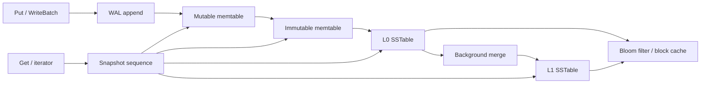
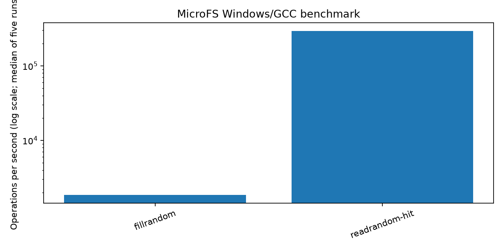

# MicroFS

**MicroFS** is an educational embedded key-value storage engine written in
C++20. It explores the core pieces of a log-structured merge tree (LSM tree):
a write-ahead log (WAL), an arena-backed skiplist memtable, immutable sorted
tables (SSTables), Bloom filters, snapshots, recovery, and background flush and
compaction. **TickStore** is a small time-series layer on the same database API
for storing and querying fixed-point market tick data.

The project is designed to make storage-engine mechanics inspectable: on-disk
records are documented, errors use an explicit `Status` API, the tests use a
small in-repository harness, and benchmark output is checked in alongside its
environment metadata. This is a learning and portfolio project, **not a
production-ready replacement for LevelDB or RocksDB**.

## What is implemented

| Component | Current implementation |
|---|---|
| Memtable | Arena-backed skiplist; bytewise user-key order with sequence-aware internal keys, deletes, and snapshot lookups |
| WAL | 32 KiB blocks, CRC32C-framed logical records, fragmentation, configurable sync policy, recovery and torn-tail truncation |
| Concurrent writes | Serialized database writes and WAL append queues with leader-based group processing |
| SSTables | Prefix-compressed data blocks with restart points, per-block CRC32C, index and filter blocks, and a fixed footer |
| Filters and cache | MurmurHash3 Bloom filters, optional byte-prefix filters, and an LRU block cache |
| Version metadata | WAL-framed MANIFEST edits, CURRENT file, sequence and table metadata, and table-range validation |
| Database API | Put, Get, Delete, WriteBatch, snapshots, iterators, properties, explicit compaction, and a LOCK file |
| Background work | Immutable-memtable flush to L0 and a background table merge into L1 |
| TickStore | Symbol/timestamp keys, fixed-point prices, varint and delta-encoded batches, time-range and last-tick queries |
| Tools | Small command-line client, deterministic benchmark executable, optional Clang/libFuzzer harnesses, and a CI workflow |

Important scope limits are listed in [Known limitations](#known-limitations).
In particular, table reads and database iterators currently materialize data
in memory, and compaction is intentionally simpler than a production leveled
compaction scheduler.

## Storage and query paths



For a write, MicroFS assigns sequence numbers, encodes the write group, and
appends it to the WAL before applying it to the mutable memtable. Concurrent
writers queue behind a leader so a processing group can share a WAL append and
sync. `Get` chooses the newest value or deletion visible at its snapshot
sequence. Full iterators currently gather and materialize the visible keyspace
before traversal. When a mutable memtable reaches its configured size, it is
rotated to an immutable memtable and flushed to L0. A single background worker
performs flushes and, when triggered, compacts installed tables.

## Build and test

### CMake

With CMake 3.20+ and a C++20 compiler:

```sh
cmake -S . -B build -DCMAKE_BUILD_TYPE=Release
cmake --build build --parallel
ctest --test-dir build --output-on-failure
```

CMake/Ninja and non-Windows compiler builds are configured in the project but
were not available for verification on the host used for the checked-in
results.

### Windows/MSYS2 GCC

The implementation was built and tested here using MSYS2 GCC:

```powershell
.\scripts\build.ps1 test
.\scripts\build.ps1 cli
.\scripts\build.ps1 bench
```

The clean GCC test run passed **27/27 tests** with
`-Wall -Wextra -Wpedantic -Werror`. The tests cover foundational utilities,
skiplist and memtable behavior, WAL fragmentation and recovery, block/table
encoding and corruption checks, Bloom filters and block cache, version edits,
database reads/writes/snapshots/iterators/reopen/flush/compaction, and
TickStore ranges. The DB randomized oracle currently runs 10,000 operations;
it does not yet meet the one-million-operation target in the original brief.

See [Testing](docs/TESTING.md) for available commands and checks that have not
been run. The CI workflow defines GCC/Clang, sanitizer, fuzz-smoke, and
benchmark-smoke jobs for a suitable Linux/Clang environment; these jobs have
not been executed as part of this Windows verification.

## Quick start: C++ API

```cpp
#include <memory>
#include <string>

#include "microfs/db.h"

int main() {
  auto env = microfs::NewDefaultEnv();
  auto opened = microfs::DB::Open(env.get(), "data");
  if (!opened.ok()) return 1;

  auto db = std::move(opened).value();
  microfs::Status status = db->Put("symbol", "value");
  if (!status.ok()) return 1;

  std::string value;
  status = db->Get("symbol", &value);
  if (!status.ok()) return 1;

  return db->Close().ok() ? 0 : 1;
}
```

All fallible public operations return `microfs::Status` or `StatusOr<T>`.
`DB::Open` accepts an `Env*`, database directory, and optional `DBOptions`.
The database must be closed before its `Env` is destroyed. `DBOptions` exposes
the write-buffer size, arena block size, immutable-memtable limit, L0 trigger,
slowdown and stop thresholds, block-cache size, table options, and WAL sync
options. WAL durability policy can be configured as sync every write, sync
after a byte threshold, or never; choose a policy deliberately for the
application.

### Snapshots and iterators

```cpp
auto snapshot_result = db->GetSnapshot();
if (!snapshot_result.ok()) return 1;
const microfs::Snapshot snapshot = snapshot_result.value();

auto iterator_result = db->NewIterator(&snapshot);
if (!iterator_result.ok()) return 1;
auto iterator = std::move(iterator_result).value();
iterator->SeekToFirst();
while (iterator->Valid()) {
  // key() and value() are views valid while the iterator remains alive.
  iterator->Next();
}

if (!db->ReleaseSnapshot(snapshot).ok()) return 1;
```

Snapshots represent a sequence-number view. Iterators expose `Seek`,
`SeekToFirst`, `SeekToLast`, `Next`, `Prev`, `Valid`, `key`, and `value`. Current
iterators own a materialized copy of their visible entries, so their memory
usage grows with the number and total size of visible keys.

## Command-line tool

Build `microfs_cli` with CMake or `.\scripts\build.ps1 cli`. The syntax is:

```text
microfs_cli DB put KEY VALUE
microfs_cli DB get KEY
microfs_cli DB del KEY
microfs_cli DB scan
microfs_cli DB stats
microfs_cli DB tick SYMBOL NS PRICE SIZE
microfs_cli DB ticks SYMBOL FROM_NS TO_NS
microfs_cli DB last SYMBOL
```

Examples:

```powershell
.\build\microfs_cli.exe .\example-db put greeting hello
.\build\microfs_cli.exe .\example-db get greeting
.\build\microfs_cli.exe .\example-db tick ABC 1700000000000000000 1234500 20
.\build\microfs_cli.exe .\example-db ticks ABC 1699999999000000000 1700000001000000000
.\build\microfs_cli.exe .\example-db last ABC
```

`PRICE` is a signed fixed-point integer with scale chosen by the caller; it is
not parsed as a floating-point currency amount. Tick timestamps are unsigned
nanoseconds. The CLI opens and closes the DB for each invocation, making it a
convenience/debugging tool rather than a persistent interactive shell.

## TickStore

`microfs::TickStore` wraps a `DB*` and provides `AppendTick`, `AppendBatch`,
`QueryRange`, `LastTick`, and `ScanAll`. Tick keys reserve a namespace, then
encode a zero-escaped symbol and a big-endian 64-bit nanosecond timestamp. This
preserves bytewise symbol/time order and avoids confusing ordinary user DB
keys with tick entries.

An append batch belongs to one symbol and must contain strictly increasing
timestamps. Each batch is stored as one DB record: its key supplies the first
timestamp, and its value stores the count followed by zig-zag/varint
fixed-point price, size, and subsequent timestamp/price deltas. Out-of-order
appends are rejected; there is no correction/upsert API. `QueryRange` uses an
inclusive `[from_ns, to_ns]` interval. Multi-symbol scans return decoded ticks
in DB key order (symbol, then timestamp).

## Measured results

The checked-in benchmark is a narrow baseline, not a general database ranking:
five measured repetitions of 10,000 operations per workload after one warmup.
The benchmark uses a fixed seed and a logarithmic latency histogram.

| Workload | Median throughput | Median p50 latency | Median p99 latency |
|---|---:|---:|---:|
| `fillrandom` | 1855.50809619 ops/s | 359423 ns | 3538943 ns |
| `readrandom-hit` | 293887.723134 ops/s | 2207 ns | 7215 ns |

The raw samples are in
[`results.json`](bench/results/windows-gcc-2026-10-29/results.json) and
[`results.csv`](bench/results/windows-gcc-2026-10-29/results.csv). The captured
environment is in
[`environment.json`](bench/results/windows-gcc-2026-10-29/environment.json):
Windows 11 Pro (10.0.22621), Intel Core i5-4300U @ 1.90 GHz, 4 logical
processors, 8249847808 bytes RAM, MSYS2 GCC 16.2.0, and
`-std=c++20 -O2 -Wall -Wextra -Wpedantic -Werror`. The workspace's physical
storage type was not queried. These results were produced with WAL sync set
to `never`; the measured data remained in the memtable and the timed writes do
not measure durable persistence. No LevelDB/RocksDB comparison is claimed.



To reproduce the five-run benchmark on the Windows host:

```powershell
.\scripts\run_bench.ps1 -Operations 10000
```

See [Benchmark methodology](docs/BENCHMARKS.md) for scope and interpretation.
The broader workload matrix, configuration sweeps, TickStore benchmark,
profiling, and measured before/after optimization study remain incomplete.

## On-disk design and project documentation

- [Architecture and data flow](docs/ARCHITECTURE.md)
- [WAL, table, version, and TickStore formats](docs/FORMAT.md)
- [Design decisions and platform scope](docs/DECISIONS.md)
- [Test instructions and verification status](docs/TESTING.md)
- [Benchmark methodology and raw results](docs/BENCHMARKS.md)
- [Performance log](docs/PERFORMANCE_LOG.md)
- [Project summary and interview preparation](docs/RESUME.md)

## Known limitations

- This implementation is not production-ready and has not been compared
  against LevelDB or RocksDB.
- Compaction currently merges all installed tables into one L1 output. It does
  not implement bounded level selection, a k-way streaming merge, or complete
  production tombstone/drop decisions across levels.
- Iterators materialize the visible keyspace. SSTables are loaded through the
  `Env` abstraction; mmap and pread are not implemented.
- The database oracle has 10,000 randomized operations, not the specified
  million. Thousands of randomized crash cases and crash injection throughout
  flush, compaction, and manifest updates remain outstanding.
- POSIX builds, CMake/Ninja, Clang, AddressSanitizer, UndefinedBehaviorSanitizer,
  ThreadSanitizer, and libFuzzer runs were not verified on the Windows/MSYS2
  host.
- Hardware CRC32C acceleration, CPU/SIMD paths, broad benchmark sweeps,
  profiler-guided tuning, and a measured TickStore compression comparison are
  not implemented or not verified.
- The chart represents only the two narrow workloads shown; it is not evidence
  of scaling, disk behavior, or durability.

See [DECISIONS.md](docs/DECISIONS.md) and [PERFORMANCE_LOG.md](docs/PERFORMANCE_LOG.md)
for implementation choices and explicit verification boundaries.
