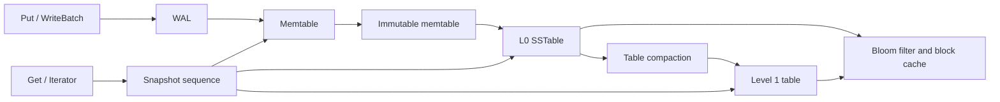

# MicroFS and TickStore

MicroFS is an embedded C++20 key/value engine built around a WAL, arena-backed
memtable, compressed SSTables, filters, snapshots, and background flush and
compaction. TickStore stores timestamped fixed-point market ticks on the same
DB API. This is an educational implementation, not a production-ready
replacement for LevelDB or RocksDB.

## Data paths



Writers append to the WAL before publishing the group to the memtable.
Snapshots select a sequence number; Get and materialized iterators choose the
newest visible value or deletion at that sequence. Memtables flush to L0 and a
background worker currently compacts installed tables into a single L1 table.

## Quick start

On a C++20 toolchain with CMake 3.20+:

```sh
cmake -S . -B build -DCMAKE_BUILD_TYPE=Release
cmake --build build
ctest --test-dir build --output-on-failure
```

On the Windows/MSYS2 GCC setup used for the checked-in run:

```powershell
.\scripts\build.ps1 test
.\scripts\build.ps1 cli
```

The current host build runs the self-contained **27-test** suite with
`.\scripts\build.ps1 test`; platform/tool availability and unrun validation are
listed under [limitations](#limitations).

Minimal C++ use:

```cpp
auto env = microfs::NewDefaultEnv();
auto opened = microfs::DB::Open(env.get(), "data");
if (!opened.ok()) return 1;
auto db = std::move(opened).value();
if (!db->Put("symbol", "value").ok()) return 1;
std::string value;
if (!db->Get("symbol", &value).ok()) return 1;
return db->Close().ok() ? 0 : 1;
```

The CLI supports `put`, `get`, `del`, `scan`, `stats`, `tick`, `ticks`, and
`last`; run `microfs_cli DB` for syntax. Tick prices are signed fixed-point
integers chosen by the caller, not floating-point currency values.

## Measured baseline

Five measured repetitions of 10,000 single-threaded operations per workload,
after a warmup, produced these medians:

| Workload | Median throughput | Median p50 | Median p99 |
|---|---:|---:|---:|
| `fillrandom` | 1855.50809619 ops/s | 359423 ns | 3538943 ns |
| `readrandom-hit` | 293887.723134 ops/s | 2207 ns | 7215 ns |

These are narrow, host-specific microbenchmarks, not general performance
claims. WAL sync was disabled and the key set remained in the memtable during
the timed intervals; in particular, the write result is not durable-write
throughput. The exact samples are committed in
[`bench/results/windows-gcc-2026-10-29/results.json`](bench/results/windows-gcc-2026-10-29/results.json)
and [`results.csv`](bench/results/windows-gcc-2026-10-29/results.csv), with
hardware/compiler/flags in
[`environment.json`](bench/results/windows-gcc-2026-10-29/environment.json).
Reproduce with `.\scripts\run_bench.ps1 -Operations 10000`.

## Limitations

- The one-million-operation oracle and thousands of randomized crash cases
  from the specification are not implemented; the current randomized DB
  oracle uses 10,000 operations.
- Compaction merges all installed tables into one L1 output. It is not a
  bounded, production leveled-compaction scheduler.
- Iterators materialize the visible keyspace. SSTables are read into memory;
  mmap/pread is not implemented.
- CMake/Ninja, Clang, POSIX, ASan/UBSan, TSan, and libFuzzer runs were not
  verified on this Windows GCC host. The CI and optional Clang fuzz targets
  are provided but have not been executed here.
- The broader workload/parameter sweeps, profiler-guided optimization, chart
  rendering, and LevelDB/RocksDB comparison remain outstanding.

See [architecture](docs/ARCHITECTURE.md), [on-disk formats](docs/FORMAT.md),
[testing](docs/TESTING.md), [benchmark method](docs/BENCHMARKS.md), and
[design decisions](docs/DECISIONS.md) and [resume material](docs/RESUME.md).
